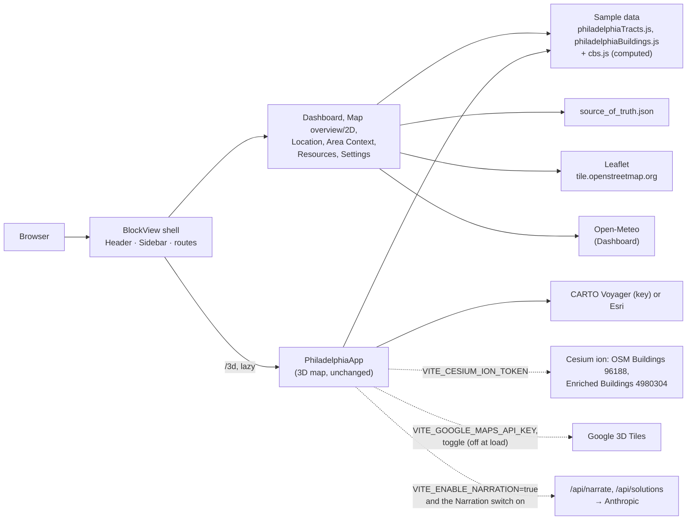

# BlockView — Philadelphia Explorer

Philadelphia. Connected. Places, maps and public data.

BlockView (repo: BlockViewPhilly) is a web app with a dashboard, a 2D map, a 3D map, and pages for places, areas and data sources in Philadelphia. The 3D map is the existing technical.me Philadelphia Pilot map, mounted unchanged inside the new BlockView shell.

**Every data value in the app is sample data.** Tract incomes, unemployment, mobility, building research spending, deal counts and the scores computed from them are hand-entered or computed in the browser from hand-entered values. They are labeled "Sample data" on screen. The only live values are map tiles, 3D building tiles, the clock and the Dashboard weather.

```bash
npm install
npm run dev              # Vite dev server at http://localhost:5173
npm run build            # production build to dist/
npm run preview          # serve the production build locally
npm run check:language   # after a build: report retired names in the bundle (report-only, exits 0)
```

There is no test runner or linter configured.

---

## Project structure

```
index.html                Page shell; loads /src/main.jsx
vite.config.js            Vite + React + vite-plugin-cesium, plus two small build plugins (see below)
vercel.json               Vercel SPA rewrite; api/ and cesium/ are excluded
.env.example              The env vars the code reads (see below)
api/                      Vercel functions: narrate.js, solutions.js (AI narration and Solutions)
public/favicon.svg
src/
  main.jsx, App.jsx       React entry and routes
  layout/                 BlockView shell: AppShell, Header, Sidebar
  pages/                  One file per route (Dashboard, MapPage, Map3DPage, LocationPage, AreaPage,
                          ResourcesPage, SettingsPage)
  ui/                     Shell components (ThemeToggle, ResourceCard, CountyCard, NavIcon, …) and the
                          3D map's panels (LayerToggles, TractList, RegionSnapshot, InspectPanel,
                          InsightsCard, StoryFeed, CompareMode, Legend, SolutionConnector, DataStamp)
  PhiladelphiaApp.jsx     The 3D map app (layout of the map and its panels)
  PhilaCesiumMap.jsx      Cesium viewer: basemap, 3D building tilesets, GPU limits
  components/Globe/Layers/PhiladelphiaLayers.jsx   Towers, circles, labels on the 3D map
  map/                    layers/* (3D map layer builders), interactions.js, LeafletView (2D), loadCesium
  core/                   cbs.js (score), insightEngine.js, narrateInsight.js, solutionConnector.js
  data/                   Sample data (philadelphiaTracts.js, philadelphiaBuildings.js, feedArticles.js),
                          config.js, source_of_truth.json (registry), registry.js, appSources.js, places.js
  hooks/                  useNarration (map), useWeather (Dashboard)
  store/                  useMapStore.js (map state), useShellStore.js (shell state)
  styles/                 index.css (map globals), shell.css (all shell styles, prefixed bv-)
tools/check-language.mjs  The check:language script
scripts/                  Offline Python data pipeline (not loaded by the app)
cache/                    Gitignored. Large local pipeline files
docs/
  data-audit/             Data audit, map spec and source-of-truth docs
  current-app-inventory.md  Every visual, panel and toggle, with its file and data type
  archive/                Old planning notes, kept for reference
```

---

## System Architecture

### Summary

A Vite + React single-page app with React Router, Zustand, Leaflet (2D) and CesiumJS (3D), deployed on Vercel. **No economic data is fetched at runtime.** All tract and building values are bundled from `src/data/philadelphiaTracts.js` and `src/data/philadelphiaBuildings.js` (every record flagged `synthetic: true`).



### Shell pages

| Route | Page | What it shows |
|---|---|---|
| `/` | Dashboard | "Philadelphia / Live" card: local clock and date, and Weather / Conditions / Wind from Open-Meteo ("Weather unavailable" if the request fails). Open 2D Map / Open 3D Map buttons, a mission placeholder, and four numbered resource cards. |
| `/map` | Location & Data | "Map context" rows (Place, Area context, Selected tract, Source lineage), Building Location / Census Data tabs, a building picker, Center selection and Reset view, and a Leaflet map with one marker per sample building. A "Philadelphia County" card lists the 11 sample tracts (there are no county-level figures). |
| `/3d` | 3D Map | The 3D map below, full-bleed in the content area. |
| `/location`, `/location/:id` | Location | One tract from the sample data: name, tags, description placeholder, area-context rows (place, local conditions, the computed indexes and score, data history), tract estimates, and the county card. `:id` is a tract GEOID. |
| `/area` | Area Context | Search over the 11 tracts and 15 places, and dataset filters that switch the 3D map's existing layers (registry metrics without a layer are shown disabled with their status). Reached from Location and Map overview. |
| `/resources` | Resources & Sources | Seven providers described as they are today (including the sample and synthetic ones), with a key status read from whether each env var is set, plus one card per source in the registry. |
| `/settings` | Settings | Light/dark theme and the 3D labels toggle (the same store value as the map's Labels checkbox). |

The shell is dark by default with a light-mode button in the header. The theme, the collapsed sidebar and which 3D map panels are shown are saved in this browser (`localStorage`). The sidebar collapses to a 76 px icon rail; the content area, including the 3D map, takes the space.

### 3D map (`/3d`)

The map app is `main`'s, unchanged except for one line: **Google 3D Tiles is off at load** (`src/store/useMapStore.js:163`). It loads `Cesium.js` only when `/3d` opens.

- **Layers:** innovation towers (universities, hospitals), investment towers (VC hub, incubators), pulsing mobility circles on tract centroids, building labels, OSM Buildings (ion 96188), Google Photorealistic 3D Tiles, and Enriched Buildings (ion 4980304) with Economic Color and a Height test style. Defaults at load: everything on except Google, Height test and Color-blind safe. While Economic Color and Enriched Buildings are on, the investment towers and mobility circles are hidden.
- **Panels:** Layers (with OSM height and Building height sliders), Tracts list, City overview (Region Snapshot), Inspect (score gauge, insight text, nearby innovation, resident outcomes, vitality bars), Top gaps (Insights), Compare, Legend, a "Sample Data" badge and sample stamps. The story feed, AI narration and the Solutions panel sit behind the "Narration and stories" switch, which is off by default.
- **GPU limits:** Google 3D Tiles has screen-space error 24, `cacheBytes` 256 MB and `maximumCacheOverflowBytes` 128 MB. OSM Buildings has screen-space error 24 and Enriched Buildings 16; both use Cesium's default cache.
- **Around the map (shell only, no map code changed):** three handles in the map's header bar (Layers, Details, Legend) show or hide the left rail, the right rail and the legend. In light mode, `src/styles/shell.css` restyles the map's panel chrome (backgrounds, borders, text, controls); the scene, layer colors and legend swatches are not changed. In dark mode a few small captions are raised to meet WCAG AA over bright parts of the map. Every text, placeholder and focus-ring pair in the shell and the map's panels was checked at 4.5:1 (3:1 for large text and focus rings) in both themes.

### Data status

| What | Source | Type |
|---|---|---|
| Street map tiles (2D), basemap (3D) | OpenStreetMap; CARTO Voyager (with key) or Esri | real (third-party tiles) |
| OSM Buildings, Google 3D Tiles | Cesium ion asset 96188; Google Map Tiles API | real (third-party) |
| Enriched Buildings footprints and colors | Cesium ion asset 4980304 | footprints from OSM; the tract values the colors read cannot be confirmed from the repo |
| Clock and date | Device clock | real |
| Weather, conditions, wind | Open-Meteo, in the browser | real (not in the source registry) |
| Tract income, unemployment, mobility | `philadelphiaTracts.js` (11 tracts, rectangle outlines) | sample |
| Building research spending, deals, vitality, stats | `philadelphiaBuildings.js` (15 buildings) | sample |
| Innovation index, outcome index, CBS, mismatch alert, top gaps | `src/core/cbs.js` | derived from sample |
| Insight text, story headlines, Solutions | `insightEngine.js`, `feedArticles.js`, `solutionConnector.js` (or `/api/*` when enabled) | derived from sample |
| Source registry statuses | `src/data/source_of_truth.json` | registry |

`docs/current-app-inventory.md` lists every visual, panel and toggle with its file, data and data type.

### Data registry

`src/data/source_of_truth.json` lists every source and metric with a status (`live`, `pipeline_ready`, `placeholder`, `not_sourced`, `retired`); `docs/data-audit/06_SOURCE_OF_TRUTH.md` is the human-readable version, and the JSON wins if they disagree. No metric is `live`. The registry feeds the Resources page's "Source registry" cards and the Area Context registry filters; the 3D map does not read it. A build plugin that can strip `retired` entries from the bundle exists in `vite.config.js` but is **off**, and `npm run check:language` only reports.

### Environment variables

`VITE_*` variables are built into the browser bundle.

| Name | Read in | Without it |
|---|---|---|
| `VITE_CESIUM_ION_TOKEN` | `PhilaCesiumMap.jsx`, `LayerToggles.jsx`, shell pages | OSM and Enriched Buildings are disabled |
| `VITE_GOOGLE_MAPS_API_KEY` | `PhilaCesiumMap.jsx`, `LayerToggles.jsx`, shell pages | Google 3D Tiles is disabled |
| `VITE_CARTO_API_KEY` | `PhilaCesiumMap.jsx` | The 3D basemap is Esri World Street Map |
| `VITE_ENABLE_NARRATION` | `narrateInsight.js`, `solutionConnector.js` | No `/api/*` request; template text is used |
| `ANTHROPIC_API_KEY` | `api/narrate.js`, `api/solutions.js` (server) | `/api/*` returns 503 |

### Decisions under review (from the 9/29 client call)

These were proposed as rules for the map. **The code does not follow them today**; which features stay, move or go is a team decision to be made with William's updated wireframe.

- The map shows data: no scores, "gaps", "opportunity" signals, mismatch alerts, story headlines, recommendations or causal claims.
- One visual layer = one dataset; datasets are never blended.
- Missing data says "No data"; never fill, never zero.
- Sample or placeholder values are not shown.

### Open issues

- **Hidden Cesium and Google credits.** `src/styles/index.css:82-83` (from `main`) hides Cesium's credit area (`.cesium-viewer-bottom`, `.cesium-widget-credits`). That area carries the Cesium ion logo and, when Google 3D Tiles is on, Google's required attribution. Check against the Cesium ion and Google Map Tiles terms.
- **Cesium ion plan.** The credit area shows "Upgrade for commercial use"; the ion Commercial tier ($149/month) is part of the open license question, as is the license file itself.
- **Sample data everywhere.** No live Census or ACS data is connected. 4 of the 11 sample tract GEOIDs are not in the TIGER 2022 file; the other 7 sit 0.7–8.1 km from their real locations.
- **Placeholders:** mission text, place descriptions, a sourced neighborhood list, margin of error.
- **Open-Meteo** is used on the Dashboard but is not in the source registry.
- **GPU limits** differ by layer (256/128 MB for Google only); a real-laptop check of OSM + Google together has not been done (tests used a software renderer).
- **`npm audit`:** the prebuilt `Cesium.js` that ships to the browser bundles DOMPurify 3.4.7 and protobuf.js 8.5.0, both in flagged ranges; the other findings are build and dev-server tools.
- **Pipeline** (`scripts/`, for its owner): `fetch_phila_tracts.py` fills missing values (`fillna(45000)`, `fillna(8.0)`, `fillna(40.0)`, `fillna(30.0)`), clips income at 0, uses income as a mobility stand-in without `--atlas`, and sets `innovationIndex` to 0.5; it and `enrich_buildings.py` still write `cbs`, `innovationIndex` and `outcomeIndex`; `enrich_buildings.py` needs an explicit `--tracts`.
- Deep links (`/location/:id`) are handled by `vercel.json`; confirm on a Vercel preview.

### Phase 5: data (blocked)

Held until William finishes the wireframe. When it lands, data is wired only from `docs/data-audit/06_SOURCE_OF_TRUTH.md` and `source_of_truth.json`, one dataset per layer (`docs/data-audit/05_MAP_SPEC.md`), with the Census fixes in `docs/data-audit/02_DATA_BREAKDOWN.md` issues 9–11 (sentinel codes → null, no default fills, percent units with margin of error, 2010→2020 tract crosswalk for the Opportunity Atlas).

### Offline data pipeline

`scripts/fetch_phila_tracts.py` pulls ACS 2022 5-year (`B19013_001E`, `B23025_003E`, `B23025_005E`) and TIGER 2022 tract shapes, plus Opportunity Atlas `kfr_pooled_pooled_p25` with `--atlas`, and writes `scripts/phila_tracts_full.geojson`. `scripts/enrich_buildings.py` joins OSM building footprints to tracts and can upload the result to Cesium ion; its large files live in the gitignored `cache/`. Nothing the pipeline writes is loaded by the app.
